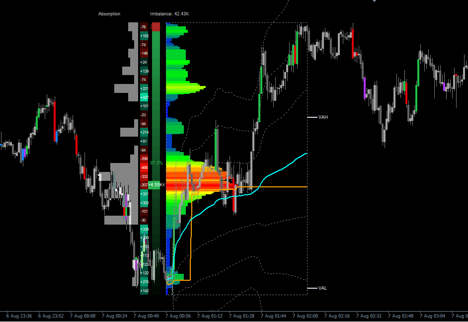
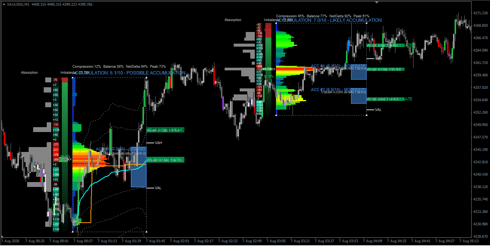

# Rectangle Volume Profile (RVP)

**Order flow & volume profile suite untuk MetaTrader 4 — cukup gambar satu rectangle, dapatkan analisa lengkap.**

*oleh Denta Ah*

---

## Daftar Isi

- [Ringkasan](#ringkasan)
- [Fitur Utama](#fitur-utama)
- [Cara Kerja (Konsep Umum)](#cara-kerja-konsep-umum)
- [Kebutuhan Sistem](#kebutuhan-sistem)
- [Instalasi](#instalasi)
- [Cara Pakai](#cara-pakai)
- [Konfigurasi](#konfigurasi)
- [Tampilan](#tampilan)
- [Disclaimer](#disclaimer)
- [Lisensi](#lisensi)

---

## Ringkasan

**Rectangle Volume Profile (RVP)** adalah indikator MT4 yang mengubah satu rectangle yang Anda gambar di chart menjadi pembacaan order flow selengkap yang biasa ditemukan di tool-tool berbayar kelas institusional — volume profile, peta likuiditas, delta buy/sell, hingga deteksi zona kekuatan dan zona accumulation, semuanya dihitung dari range yang sama dan saling konsisten satu sama lain.

Alih-alih menumpuk banyak indikator terpisah yang sering memberi sinyal saling bertentangan, RVP menyatukan beberapa "lensa" order flow di atas range yang sama persis, supaya Anda bisa saling silang-cek volume, delta, absorption, dan struktur harga tanpa gonta-ganti tool.

Cukup gambar rectangle di sekitar area harga yang ingin Anda pelajari — sisanya dikerjakan otomatis oleh indikator.

## Fitur Utama

### 📊 Volume Profile Berbasis Rectangle
Gambar rectangle di mana saja pada chart, dan RVP langsung merender histogram volume horizontal untuk range tersebut secara live — termasuk **Point of Control (POC)**, yaitu level harga dengan volume transaksi tertinggi di dalam range itu.

### 🎯 Value Area (VAH / VAL)
Menghitung dan menandai **Value Area High** dan **Value Area Low** — batas atas-bawah area di mana mayoritas volume transaksi terjadi, referensi klasik untuk mengetahui "di mana harga paling banyak diperdagangkan".

### ⚖️ Liquidity Panel & Imbalance
Panel di samping chart yang memecah range menjadi level-level harga dan menunjukkan partisipasi beli vs jual di tiap level, plus pembacaan imbalance keseluruhan — jadi Anda bisa melihat sisi mana yang lebih dominan.

### 🔥 Delta Heatmap
Peta warna resolusi intrabar yang menggambarkan delta buy/sell di sepanjang range harga, memberi gambaran jauh lebih detail dibanding hanya melihat open/close satu candle.

### 🧲 Absorption Profile
Menyorot level harga di mana dorongan beli/jual yang agresif ternyata "diserap" tanpa follow-through yang seharusnya terjadi — jejak yang sering dikaitkan dengan supply/demand tersembunyi dari pelaku besar.

### 🟩 Smart Zone (Strength Zone)
Otomatis menandai kandidat zona support/resistance dengan mengombinasikan beberapa karakteristik order flow di tiap level harga menjadi satu skor kekuatan, lengkap dengan tier (mis. Elite/Strong/Moderate/Weak) supaya Anda bisa langsung membedakan zona kuat dari zona lemah.

### 🔵 Accumulation Detection
Memindai range yang di-plot untuk mencari jejak-jejak yang umum dikaitkan dengan fase accumulation — partisipasi volume tinggi, volume yang terserap tanpa pergerakan harga berarti, level yang berulang kali diuji — lalu menandai lokasi di mana ciri-ciri itu paling terkonsentrasi. Dilengkapi **Accumulation Score** 0–10 untuk keseluruhan range beserta kesimpulan langsung dalam bahasa yang mudah dipahami (mis. *Likely Accumulation*, *Weak Signal*, *No Accumulation*).

> Semua modul di atas membaca dari rectangle dan data dasar yang sama, sehingga zona yang muncul di Delta Heatmap, Absorption Profile, maupun Accumulation Score saling konsisten — bukan hasil hitungan terpisah yang tidak berhubungan.

## Cara Kerja (Konsep Umum)

RVP dibangun di atas satu prinsip sederhana: **biarkan trader menentukan range yang relevan, dan biarkan indikator yang mengerjakan pembukuan order flow-nya.**

1. Anda menggambar satu rectangle di chart mengelilingi price action yang ingin dianalisis.
2. RVP mengambil data intrabar (timeframe lebih rendah) dari range tersebut untuk merekonstruksi perkiraan partisipasi beli/jual di tiap level harga — jauh lebih detail dibanding hanya membaca wick candle.
3. Beberapa modul skoring yang saling independen (Smart Zone, Accumulation Detection, Absorption Profile) masing-masing melihat data rekonstruksi yang sama ini dari sudut pandang berbeda, menggunakan kombinasi tertimbang dari faktor-faktor seperti volume, keseimbangan partisipasi, frekuensi retest, dan perilaku penolakan harga.
4. Semua hasilnya dirender langsung di chart — histogram, heatmap, kotak zona, dan label skor — dan diperbarui secara live setiap kali harga bergerak atau rectangle disesuaikan.

Rumus skoring dan pembobotan internal secara sengaja tidak dipublikasikan di sini. Yang didokumentasikan adalah **apa** yang diukur tiap modul secara konsep dan **bagaimana** cara mengatur (konfigurasi) perilakunya — bukan cara kerja internalnya secara rinci.

## Kebutuhan Sistem

- MetaTrader 4 (disarankan build 600 ke atas)
- Bisa dipakai di simbol/timeframe apa saja; beberapa modul mengambil data timeframe lebih rendah (M1) secara internal demi resolusi yang lebih halus, terlepas dari timeframe chart yang sedang dibuka
- Objek Rectangle (`OBJ_RECTANGLE`) yang digambar manual di chart — ini yang mendefinisikan range analisis untuk semua modul

## Instalasi

1. Salin file `.mq4` ke folder `MQL4/Indicators` pada instalasi MetaTrader 4 Anda.
2. Restart MetaTrader 4, atau refresh panel Navigator.
3. Drag indikator ke chart yang diinginkan.
4. Gambar rectangle di chart — RVP otomatis mendeteksinya dan langsung menganalisis range di dalamnya.

## Cara Pakai

1. Pasang RVP ke chart.
2. Gambar rectangle (`Insert → Shapes → Rectangle`, atau tool rectangle bawaan platform Anda) mengelilingi range harga yang ingin dipelajari.
3. RVP secara otomatis akan:
   - Menampilkan volume profile dan POC untuk range tersebut
   - Menandai Value Area
   - Mengisi Liquidity Panel dan Delta Heatmap
   - Menandai Smart Zone dan zona Accumulation yang ditemukan (jika ada)
4. Geser atau ubah ukuran rectangle kapan saja — semua modul menghitung ulang secara live.
5. Sesuaikan modul mana yang ingin ditampilkan dan seberapa sensitif masing-masing lewat parameter input (lihat bagian Konfigurasi).

## Konfigurasi

Input dikelompokkan per modul (Volume Profile, Value Area, Liquidity Panel, Delta Heatmap, Absorption Profile, Smart Zone, Accumulation Detection), sehingga Anda bisa:

- Menyalakan/mematikan tiap modul secara independen
- Mengatur warna, opacity, dan ukuran font agar tampilan chart lebih bersih atau lebih menonjol sesuai selera
- Menyesuaikan ambang sensitivitas (mis. jumlah kandidat zona yang ditampilkan, skor minimum agar zona dianggap valid) supaya cocok dengan karakter volatilitas instrumen dan gaya trading Anda sendiri
- Mengatur seberapa jauh kotak zona ditampilkan dan seberapa detail informasi yang ditampilkan di dalamnya

Setiap modul bisa dijalankan berdampingan atau sendiri-sendiri — matikan saja modul yang tidak Anda butuhkan.

## Tampilan

*(Tambahkan screenshot chart di sini, mis.:)*

```


```

## Disclaimer

RVP adalah tool visualisasi order flow yang bersifat **statistik/heuristik**. Skor, zona, dan label apa pun yang ditampilkan (termasuk *Accumulation Score* dan tier zona) mencerminkan jejak pada data volume dan harga historis di dalam range yang di-plot — **bukan** sinyal trading, jaminan hasil, atau pengganti analisa struktur pasar, manajemen risiko, dan penilaian Anda sendiri. Selalu validasi dengan konteks tambahan (struktur higher-timeframe, berita, aturan strategi Anda sendiri) sebelum mengambil keputusan trading.

## Lisensi

*All Rights Reserved*


